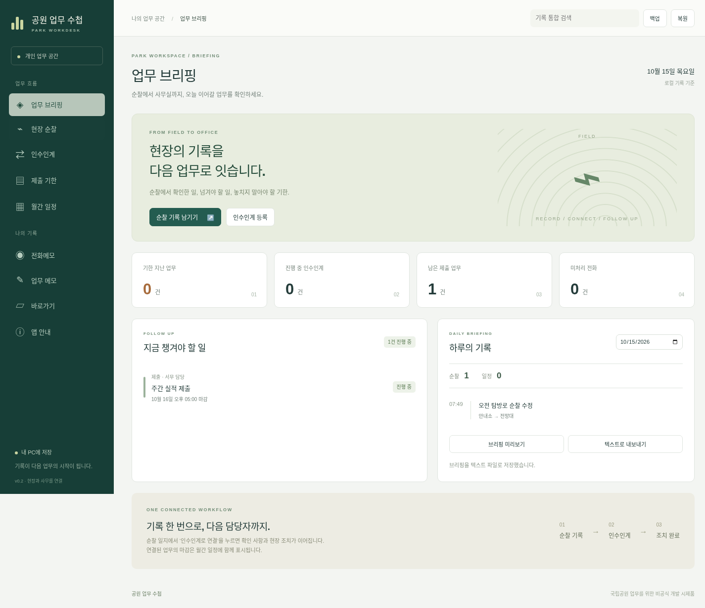

# 공원 업무 수첩 · v0.2

국립공원 현장과 사무실의 업무를 연결하는 **Windows 10/11용 개인 업무 기록 시제품**입니다. 순찰에서 확인한 사항을 인수인계로 넘기고, 제출 기한과 일정을 함께 관리합니다. 공식 기관 제품·결재·근태·긴급 대응 시스템은 아닙니다.



## 이번 버전에서 사용할 수 있는 기능

- **업무 브리핑**: 미완료 인계·제출, 지난 기한, 미처리 전화와 날짜별 순찰·일정 확인. 선택 날짜의 브리핑을 TXT로 내보내기.
- **현장 순찰**: 구간·기록자·확인 등급·확인 사항·현장 조치 등록, 검색, 수정, 삭제.
- **인수인계**: 순찰 기록에서 후속 조치로 연결. 담당자·마감일·우선순위·완료 일시 관리. 같은 순찰의 미완료 조치는 다시 열어 중복 생성을 방지.
- **제출 기한**: 서류명·담당자·제출처·마감일, 1일 전/1시간 전/마감 시각 알림과 제출 완료 기록.
- **월간 일정**: 개인 일정·순찰·인계·제출 기한을 함께 표시. 원본 변경이 바로 반영되며 별도 복제 일정은 생성하지 않음.
- **전화메모·업무 메모**: 등록, 검색, 수정, 삭제와 전화 처리 상태.
- **통합 검색**, 폴더 바로가기, 전체 JSON 백업·복원.

법령 반입·검색, ERP·공용 근무현황판, 거점표·당직표 자동 편성, 예산·급량비·물품 장부, 좌표 변환은 후속 단계입니다. 월간 달력의 공휴일·음력, 반복 일정, 트레이 상주도 아직 제공하지 않습니다.

## Windows에서 확인하기

회사 네트워크에서 개발용 패키지를 설치할 필요가 없도록 [Windows 빌드](https://github.com/Recon987/AI-Coding/actions/workflows/windows-build.yml)를 준비했습니다.

1. GitHub에 로그인하고 **성공 표시가 있는 최신 빌드 실행**을 엽니다. 성공 기록이 없다면 아직 실행 파일이 준비되지 않은 상태입니다.
2. 실행 페이지 하단 **Artifacts → park-workdesk-windows-숫자**를 내려받고 압축을 풉니다. 보관 기간은 14일입니다.
3. 설치하려면 이름에 `Setup`이 있는 EXE, 설치 없이 시험하려면 나머지 portable EXE를 사용합니다. 저장 데이터는 두 방식 모두 앱의 사용자 데이터 폴더에 남습니다. USB에 EXE만 복사해도 사용자 데이터가 함께 이동하지 않습니다.
4. 동일 묶음의 `SHA256SUMS.txt`와 `Get-FileHash <파일명> -Algorithm SHA256` 결과를 대조할 수 있습니다.

실행 PC에 Node.js나 Python 설치는 필요하지 않습니다. 인터넷 PC에서 파일을 받은 후 기관 반입 절차를 따르세요. 코드 서명은 아직 설정하지 않았습니다. 기관 PC에서 실행이 차단되면 승인 절차를 확인하세요. 자동 빌드는 소스 실행과 패키징된 앱의 업무 흐름을 각각 검사합니다. 기관 실기기 승인 검증은 별개입니다.

## 개발자 실행

Node.js 24와 npm 기준입니다. 기존 체크아웃에서 작업하며 별도 Git worktree는 필요하지 않습니다.

```sh
npm ci
npm test
npm run desktop
```

`npm run dev`는 브라우저 개발 모드입니다. 별도 localStorage를 사용하며 OS 알림·폴더 열기·백업·TXT 내보내기는 데스크톱 앱에서만 제공됩니다. 브라우저와 데스크톱 데이터는 자동 공유되지 않습니다.

직접 Windows 패키지를 빌드하려면 인터넷이 되는 Windows PC에서 `npm run package:win`을 실행하세요. `release/`에 NSIS 설치 파일과 portable EXE를 생성합니다. 첫 빌드에는 npm·Electron·NSIS 도구 다운로드가 필요합니다. 설치된 앱의 화면과 기능은 외부 CDN, 자동 업데이트, API 호출 없이 동작합니다.

## 저장·기존 자료 보존

Electron 사용자 데이터 폴더의 `workdesk.json`에 저장합니다. Windows에서는 통상 `%APPDATA%/park-workdesk/`입니다. v0.1 자료는 첫 실행에서 원본 `workdesk.json.v1-backup.json`을 보관한 뒤 v2 형식으로 전환합니다. 메모·일정·전화·바로가기는 유지됩니다. v0.1 앱은 v2 파일을 읽지 못하므로 이전 앱으로 되돌릴 때는 원본 백업을 별도로 보존하세요.

백업에는 순찰·인계·제출을 포함한 모든 기록과 폴더 경로가 들어갑니다. 복원은 현재 자료를 교체하며 교체 전 자동 보관 파일을 남깁니다. 연결이 끊긴 순찰 ID 등 잘못된 자료는 복원 전에 거부합니다. 폴더 연결은 PC별 경로를 사용합니다. 저장·반입 한도는 JSON 20MB, 각 기록 종류 10,000건입니다.

**저장 파일·백업·브리핑은 현재 암호화되지 않습니다. 가상 자료로 시험하세요.** 민원인 정보 등 실제 업무자료를 넣기 전 접근 통제·암호화·기관 정책 검토가 필요합니다. 앱은 다중 사용자 공유 DB를 지원하지 않으며 공용 폴더의 파일을 여러 PC가 동시에 수정하는 방식으로 쓰면 안 됩니다.

알림은 앱이 실행 중이고 PC가 깨어 있을 때 15초 간격으로 확인합니다. 1분 이상 지난 알림은 재생하지 않으며 지난 업무는 브리핑에 남습니다. 실행 세션에서 같은 알림을 중복 표시하지 않습니다. 창을 닫으면 앱이 종료됩니다. Windows 알림 허용 설정이 필요합니다.

## 검증과 구조

- `npm test`: 기존 자료 전환·보존, 순찰/업무 연결 무결성, 백업 왕복, 달력 원본 연계, 사전 알림, 브리핑 범위 검사.
- `npm run test:desktop`: 실제 Electron에서 순찰→인수인계, 제출·달력, 검색, 완료 처리, 백업·복원/오류 거부, TXT 출력, 프로세스 재실행과 폴더 등록 확인. 파일 선택 대화상자만 테스트에서 대체합니다.
- Linux 자동 검증에서만 headless 및 `--no-sandbox`를 사용합니다. 실제 앱의 renderer sandbox 설정은 유지합니다. Windows 알림 표시·탐색기 실행·기관 PC 설치는 [실기기 확인](docs/windows-checklist.md)이 필요합니다.

[전체 검토 및 개발 우선순위](docs/project-review.md) · [기술 구조](docs/architecture.md) · [참고 자료와 독립 구현 범위](docs/reference-notes.md)
