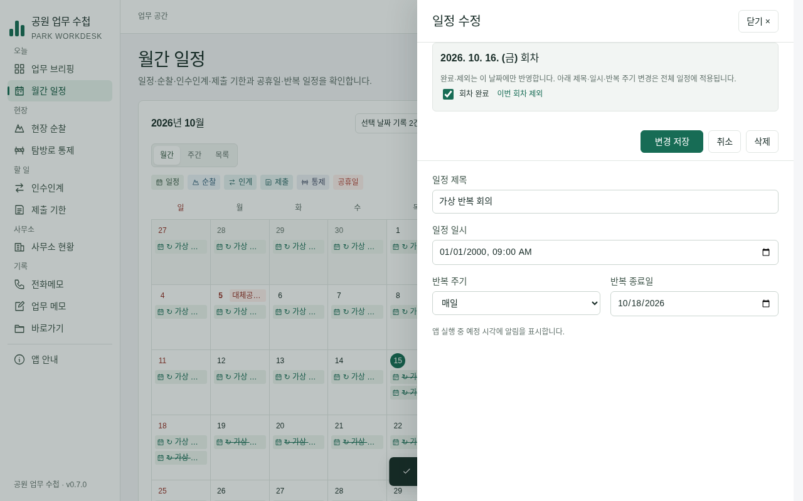
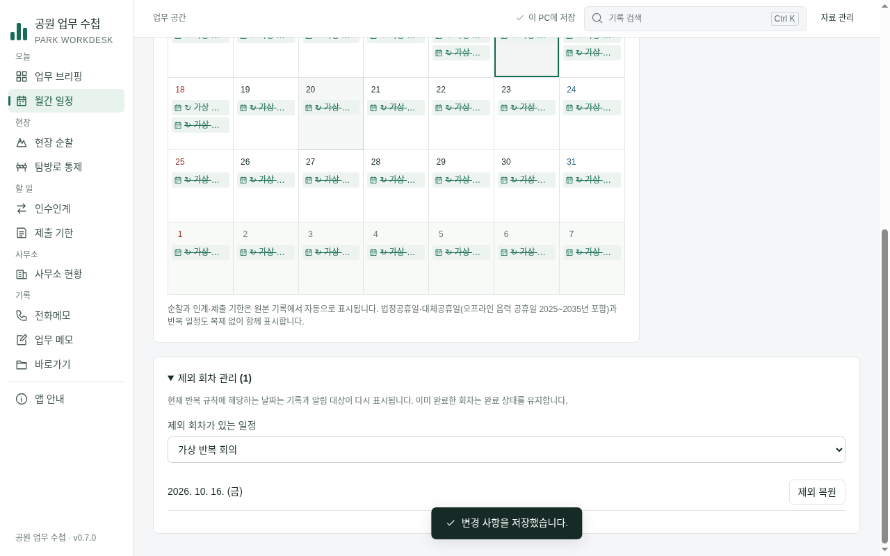

# TASK-CALENDAR-02 — 반복 회차 완료·제외·복원

구현 브랜치 `task/task-calendar-02`. Claude PR #1을 검증·보완한 PR #2 위에서 진행했다. main과 Claude 원 브랜치는 변경하지 않았다. 작업 상태는 **review**, 최종 검증자 Claude의 통합 대기다.

## 사용 동작

- 월간·주간·목록의 회차 완료는 그 날짜만 완료한다. 다음 미완료 회차의 알림은 유지한다.
- 이번 회차 제외는 원본 일정 삭제 없이 달력·브리핑·알림에서 해당 날짜를 뺀다. 원본 기반의 제외 회차 관리에서 되돌린다.
- 완료했던 회차를 제외/복원하면 완료를 보존한다. 반복 규칙 변경 후 남은 과거 제외일도 제거할 수 있다. 현재 규칙에 없는 날짜는 복원해도 새 회차를 만들지 않는다.
- 기존 done=true는 전체 완료를 의미한다. 명시적인 전체 완료 해제 확인을 제공한다. 제목·시각·반복 설정은 전체 원본 수정이다.
- 초안이 있으면 회차 버튼을 잠그고, 회차 저장 중에는 편집 입력도 잠근다. 실패는 모달 내부에 표시하고 원본/초안을 유지한다. 반복 해제의 회차 상태 제거는 저장 전 확인한다.

## 독립 개선 루프

모델 구현자는 shared/model과 선언·타입·전용 단위 검사를 담당했다. 다른 자료 보존 검토자가 희소 배열이 JSON null로 변해 다음 실행에 실패할 가능성과 규칙 변경 후 제외일을 되돌릴 수 없는 경계를 발견했다. 밀집 배열 검사와 기존 메타데이터 제거 허용으로 보완 후 승인했다.

UI 구현자와 다른 UX 검토자가 실제 캡처/코드를 보고 저장 중 타이핑 유실·모달 밖 오류·오래된 원본의 미래 회차 이동·설명과 상태 표시를 검토했다. 입력 잠금·내부 오류·선택 날짜 우선 이동·회차 완료 라벨로 보완해 교차 승인을 받았다. 제품의 미적 완성도나 기관 사용자 사용성 검증을 대신하지는 않는다.

## 실제 앱 화면 (가상 자료)

## 검증

- Node24 npm test **81/81**; 회차 전용11개는 UTC·서울·뉴욕에서 실행. 최종 자료 검증 보완은 UTC·서울에서 다시 확인했다.
- npm run test:desktop **전체 통과**. 실제 Electron·임시 자료·동결 시계로 완료/다음 알림/브리핑 TXT/제외 복원/기존 전체완료/메타 수정 보존/반복 해제 취소/백업 복원/재실행을 확인했다.
- 실제 IPC 실패와 지연 저장을 주입해 모달 오류·원본 보존·입력 잠금도 검증했다. CSP unsafe-eval이나 renderer 격리 완화 없이 실행했다.
- UI **142개 통과**, 페이지 오류0·외부 요청0. 업무 흐름 **10/10**. 임시 결과 `/tmp/park-workdesk-review/calendar02-final`, `/tmp/park-workdesk-flows.json`.
- Windows 새 소스/패키지 검증은 푸시 후 기록한다. 기반 b03d6cf는 Actions38896149700에서 성공했다.

기관 PC의 실제 절전/토스트·스크린리더·높은 DPI, 법령 공휴일 변경과 사용자 용어·서식 검토는 별도다. 새 외부 API/패키지/IPC와 데이터 스키마 버전 전환은 없다. 이전 버전 앱은 새 회차 상태를 알지 못하므로 되돌리기 전 전체 백업을 보관한다.
