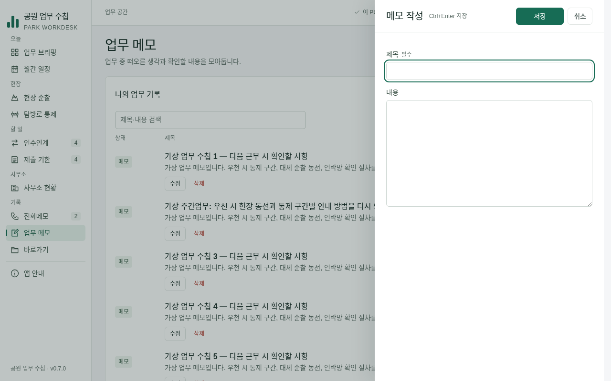
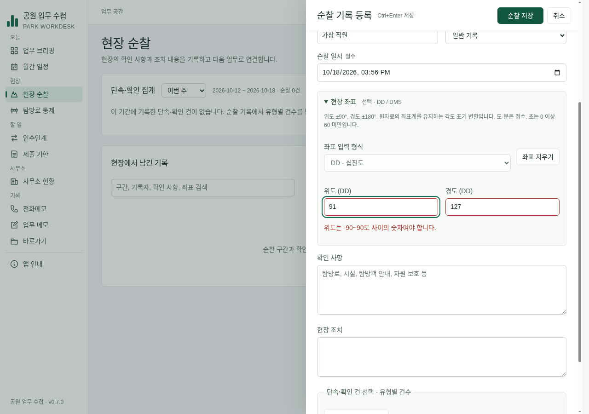

# EDITOR-01·02 Codex 독립 검증

기준은 Claude `9e2d719b013ce6965b12b2409c320421ae916f7d`이며, 수정 브랜치는 `task/task-review-editor-01`이다. 원 구현자와 별도 입력 검증·저장 안전·UX 검토자가 확인하고 총괄 Codex가 재현·수정·전체 검사를 담당했다. main/Claude 원 브랜치에는 직접 쓰지 않았다.

## 판정과 보완

EDITOR-01의 한 줄 머리·480/600px 크기·Ctrl/Cmd+Enter·취소 보호는 승인한다. EDITOR-02는 아래 두 오류를 보완한 결과를 승인한다. 원본 9e2d719의 전체 검사와 Windows는 성공했지만 기존 검사가 이 경계를 다루지 않았다.

| 발견 | 실제 재현과 영향 | 보완 |
| --- | --- | --- |
| P2 접힌 오류 칸으로 포커스 이동 실패 | 위도91/경도127 입력 후 좌표 영역을 접고 저장. 저장은 거부하지만 포커스는 저장 버튼에 남고 '표시된 칸을 고치라'는 안내와 달리 오류 칸은 보이지 않는다. 순찰 좌표와 단속 건 위치 각각 재현 | focusFirstInvalid가 실제 활성 input/select/textarea만 찾고 상위 details를 모두 펼친 뒤 포커스. 닫힌 폼은 건너뜀 |
| P1 사무소 탭의 저장 중 가드 누락 | CSV 반입 미리보기→저장을 지연→근무현황 탭 이동→저장 실패→반입 탭 복귀. 실제 조직0건인데 CSV는빈문자열·미리보기0개 | 탭을 native disabled로 만들지 않고 aria-disabled와 클릭/방향키 busy 가드를 적용. 저장 실패 후 CSV 원문/미리보기/포커스 보존 |

독립 재검토에서 두 수정 모두 승인됐다. 신규 `tests/desktop-editor-smoke.cjs`는 수정 전3개 전부 실패했고 수정 후 모두 통과했다. 순찰/단속의 오류 설명 연결·다른 초안 보존·정정 후1건 저장, 반입의 실제 DOM 클릭/Home/방향키·상위 메뉴 이동 차단·실패0건·성공 재시도1건·저장 후 정상 탭 이동까지 검증한다. 테스트만 IPC 저장 응답을 지연·실패시키며 앱의 보안 설정/운영 IPC는 바꾸지 않는다.

## 독립 검토

- UX: 1280×800/960×680, 100/125%, 전화·순찰·긴 일정 수정·양식의16조합. 머리68px·480/600px 폭·제목/힌트/버튼 겹침0·가로 넘침0. 빈 제목 Ctrl+Enter는 제목 포커스, 본문 Cmd+Enter는 실제 저장. 승인.
- 입력: Field의 필수·힌트·오류ID 병합과 설명 연결, 접힌 순찰/단속 오류 helper 수정 후 실제 Electron으로 재승인.
- 저장 안전: ListRow 5회 연타→IPC1회, 성공/실패의 원본·동일 버튼 포커스 유지, Calendar 완료 연타 가드 정상. CSV 탭 결함은 독립 지연 IPC 재검사에서 초안·미리보기·포커스 유지 확인 후 승인.

## 직접 전체 검사

기준 소스와 수정본 모두 Node24.19에서 npm test **89/89**, 전체 Electron·화면142·업무흐름11/11 통과. 수정본 test:desktop는 기존7개+새편집회귀의 **8개 진입점**이다(기존 콘솔 PASS 시나리오 수와 혼동하지 않음). 화면 실패0·페이지오류0·외부요청0, `/tmp/park-workdesk-review/editor-verified`.

정확한 원본9e2d719의 [Windows39105341497](https://github.com/Recon987/AI-Coding/actions/runs/39105341497)은 성공했다. 원본의 성공과 두 오류를 고친 소스의 Windows 결과를 구분한다. 보완본은 푸시 후 workflow_dispatch로 확인한다.

## 실제 화면 (가상 자료)

## 한계와 다음 작업

빈 필수 값은 브라우저의 기존 required 검증, 홈의 범위 밖 즉시 동작은 기존 disabled 정책을 유지한다. 기관 PC의 실제 화면낭독기·키보드·고대비·OS 알림·절전은 미검증이다. 데이터v3·기존 IPC·오프라인 실행·renderer 격리 유지, 새 패키지 없음. 후속 후보는 기존 TASK-DATES-01이며 스키마/암호화/서식 정책을 이번에 확정하지 않았다.
