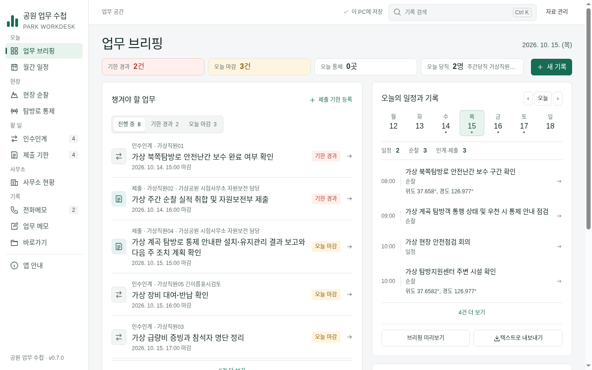
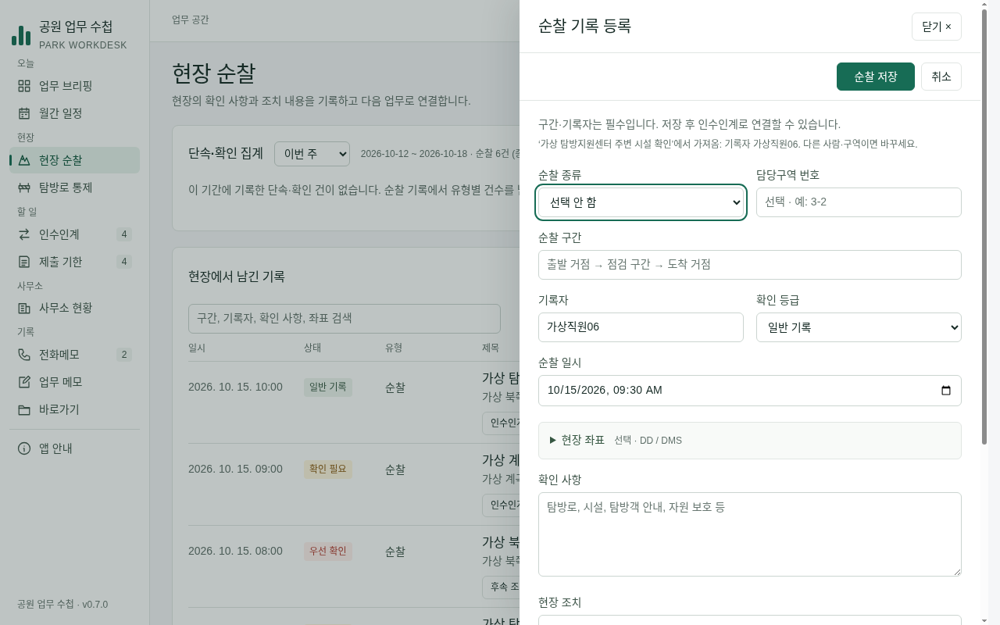

# Claude 최신 개선의 Codex 독립 검증

- 대상: TASK-POLISH-01·TASK-PANEL-01, Claude 소스 `ad40b1863ec5373f3fb9de92c94e625b3c777f71`.
- 비교 기준: 직전 Codex 회차 작업 `a932812`. 기존 보완·회차 관리가 Claude 브랜치에 통합됐음을 조상 관계로 확인했다.
- 검증 브랜치: `task/task-review-panel-01`. 기존 main/Claude 브랜치를 직접 수정하지 않았다.
- 판정: **두 카드의 완료 조건 승인**. 새 차단 결함은 없었으며 앱 코드 수정도 필요하지 않았다. main 병합 전이므로 카드 상태는 review를 유지한다.

## 세 분야 검토와 상호 확인

| 분야 | 확인한 계약 | 독립 증거·판정 |
| --- | --- | --- |
| 자료 안전·복구 | 시작·복원 경고의 화면 전달, 잠금/손상 구분, 원자 저장과 보호본, v1/v2 매회 원본 사본, 메모·일정 편집의 미지 행 필드 보존 | 저장/복구33개 통과. EPERM/EBUSY/EACCES 각2회 실패 후 성공, 지속 잠금5회 중단, 주/보호본 바이트 보존, 복구 확정 후 보호본 실패 경고1회 독립 주입. 승인 |
| 모델·검색 | 시간대와 독립적인 정상 파일 읽기, 근무·당직/전날 단속의 단일 원본, 복사 금지 필드, 자동 제목, 통합/화면 검색 일치 | 관련17개 통과. 저장5TZ×읽기5TZ×연초/연말/DST4일×3시각×offset유무2=600개 정상 자료 모두 통과. 당직자만 이름·전날 건수/날짜, 새 초안의 조치·좌표·단속 건 제외·검색 불변 확인. 승인 |
| 화면·접근성·입력 | 마지막 추가 기록의 기본값/실제 출처, 명시 복사, 초안 취소 보호, 행 동작 이름·근무표 이름, 달력 탭·통제 원본 이동 | 별도 실제 Electron 임시 프로필: 최신 시각 기록과 마지막 추가 기록을 다르게 둔 기본값, 출처·복사 필드, 우선 포커스, Esc→계속작성, 복사 시 확인·조치·위험 초기화, 방향키·선택탭포커스·tabpanel 연결 통과. 승인 |

세 검토자는 파일을 수정하지 않았다. 총괄 Codex는 각 발견을 원 합의안과 대조하고 아래 전체 검사를 직접 실행했다. 마지막 추가 기록을 기본값으로 쓰는 것은 3차 합의에서 변경 이유가 명시돼 있으므로 과거 '최신 at' 조건과의 불일치로 반려하지 않았다.

## 직접 실행한 전체 검사

- Node24.19.0, npm test **89/89**.
- npm run test:desktop 전체 통과. 스크립트 진입점은7개이며 첫 진입점이 PC설정/트레이 정책 검사도 호출해 PASS 로그는8종이다. 기관 PC의 실제 OS 토스트·절전과 구분한다.
- 화면 검사 **142개**, 실패0·페이지오류0·외부요청0. 1280/1360/960 및125% 조건은 기존 검토 도구를 그대로 사용했다. 결과 `/tmp/park-workdesk-review/panel-baseline`.
- 업무 흐름 **11/11**. 명시 복사 T2c는3클릭·1칸·5자, 수동 입력 기준 T2는5클릭·6칸·39자. 이는 정해진 자동화 과업의 비교이며 사람의 업무 시간 측정이 아니다.
- 업무 흐름 도구의 T2 해설에 남은 '종류/유형 선택지가 없다' 문구를 현재 기능에 맞게 바로잡았다. 조작과 단언·수치는 바꾸지 않았다.

## Windows의 동일 소스 확인

[Actions39102593618](https://github.com/Recon987/AI-Coding/actions/runs/39102593618), head **ad40b18**, 성공. 단위89개와 소스 Electron·패키징 EXE의 목록/복사/필드 보존/회차/보호본 경고 검사에서 각각 PASS를 로그로 확인했다. NSIS·portable 생성·SHA256SUMS·업로드도 성공했다. 시작 복구 스모크는 -r 주입이 필요한 소스에서만 실행한다.

[검증한 설치형·portable 다운로드](https://github.com/Recon987/AI-Coding/actions/runs/39102593618/artifacts/12127536294) — GitHub 로그인 필요·보관14일. 앱 버전은 기존과 같은0.7.0이므로 소스 해시로 구분한다. 이 검증 브랜치의 변경은 문서와 과업 해설뿐이고 실행 앱 코드는 위 Windows 검증 소스와 동일하다.

## 직접 본 화면 (가상 자료)

## 남은 후속

- EDITOR-01: 큰 편집 머리·필수/오류 연결·저장 중 입력과 포커스. 기존 카드의 다음 구현 대상이며 이번 합의 구현의 차단 결함은 아니다.
- DATES-01: offset 없는 timestamp와 역순 외부 종료일의 호스트별 허용 차이를 명시적으로 검증. 정상 자료600건의 읽기는 모두 통과했다.
- 단속 건별 좌표·조치 결과 검색은 기존에 없으며 이번 통합/화면 검색 일치 범위에 포함하지 않았다.
- 기관 PC에서 실제 백신/OneDrive 파일 잠금·절전·토스트·스크린리더와 공식 용어/서식 확인은 미실행.
- 새 스키마 혼용 정책·암호화·기관 서버 연동을 이번 검증에서 임의 확정하지 않았다.
- 이전 PR #2는 이미 병합됐고 PR #3도 원 브랜치 조상에 포함되나 GitHub에는 열려 있다. 총괄이 상태를 정리하고 PR #1 병합 절차를 진행한다.
