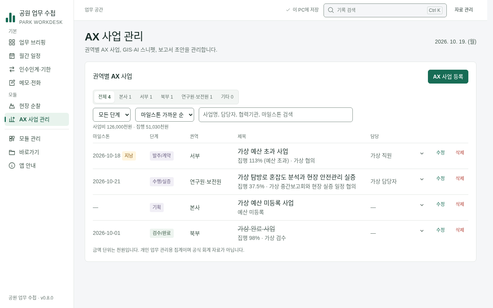
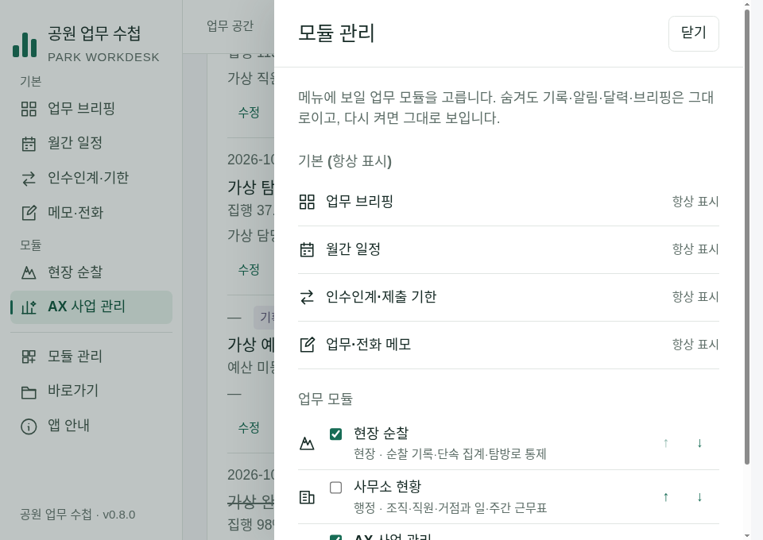

# 모듈·AX 사업 관리 독립 검증 — 2026-10-19

검증 기준은 Claude의 e671160, 실행 코드는 e6fd498이다. main은 1eb40aa다. 자료 안전성·화면/접근성·달력/브리핑 연동을 각각 읽기 전용 전문가가 검토하고 Codex가 검사·실제 화면·Windows 로그를 대조했다. 제품 코드·기존 테스트·IPC·스키마는 수정하지 않았다. AXDESK-02는 이번 작업 범위 밖이다.

## 판정

| 대상 | 독립 판정 | 다음 상태 |
| --- | --- | --- |
| MODULES-01 | 자료 보존·백업 통과. MOD-01/P2 설정 64KB 계약 보완 요청 | in-progress, Claude 보완 |
| MODULES-02 | 기능 승인. 서랍 실패·포커스·숨김·순서·읽기 전용 통과 | 선행 MODULES-01 보완 때문에 blocked |
| AXDESK-01 | 일반 업무 기능 승인. 원본 파생·CRUD·집행률·필터/정렬·실패 초안 보존 통과 | 선행 의존 보완 때문에 blocked. AX-DATE-01/P3는 별도 후속 |
| BK-01 | **해결 승인** | 미래 시각 보호본이 있어도 새 복원 직전 보호본 유지 |
| HL-01 | **해결 승인** | 직접/붙여 넣기 한도 초과에 화면 안내·초안/원본 보존 |

전체 묶음의 무조건적인 main 병합 승인은 MOD-01 보완까지 보류한다. blocked는 MODULES-02·AXDESK-01의 정상 기능이 실패했다는 의미가 아니다. 낮은 연도 P3는 일반 업무 연도에서의 승인을 뒤집는 결함으로 취급하지 않는다. 총괄은 보완 후 MODULES-01→02→AXDESK-01 의존 상태를 순서대로 복구하고 사용자 병합 승인 절차를 이어간다.

## 재현한 발견

### MOD-01 / P2 — 설정 크기를 바이트 대신 글자 수로 검사

`shared/applets.mjs`의 `JSON.stringify(configs).length > 64 * 1024`는 UTF-8 바이트 수가 아니다. `{ patrols: { text: "가".repeat(30000) } }`는 30,023자, **90,023바이트**이지만 허용된다. ASCII 70,000자는 거부되므로 기존 ASCII 검사만으로는 발견하지 못했다.

카드가 명시한 64KB 한도와 실제 허용량이 다르다. 전체 20MB 저장 검사는 계속 작동하고 이 재현에서 자료 손실은 없다. 순수 공유 로직에서 UTF-8 크기를 계산하고 한도 이하·정확히 한도·초과를 ASCII/한글로 검증한다. 이미 허용했던 큰 설정을 임의 삭제·축소하지 말고, 기존 파일을 만나는 경우의 안내·원본 보존도 확인해야 한다.

### AX-DATE-01 / P3 — 허용한 100년 미만 연도를 바꿔 파생

`shared/ax.mjs`의 `new Date(y, m - 1, d)`는 JavaScript의 1900년 보정 때문에 `0099-10-21`을 1999년으로 만든다. `validateAxProjects`는 이 날짜를 허용한다. 브리핑은 원본 문자열 날짜를 조회하므로 달력의 파생 날짜와 다르다. `0001`도 `1901`이 된다. 생성 시 `0100`·`2026`은 보존된다.

현실 업무 연도의 기능 실패로 과장하지 않고 [TASK-AX-DATES-01](../tasks/TASK-AX-DATES-01.md)에 P3로 기록했다. 연도를 보존하는 생성 방식으로 보완하고 공유 날짜 키의 4자리 패딩도 함께 확인한다. 날짜 검증 범위를 임의로 좁혀 기존 허용 자료를 버리는 방식은 피한다.

재현 명령: `TZ=Asia/Seoul node tests/modular-contract-audit.cjs`. 종료 코드 **1**, 두 사례 모두 실패한다. 이 감사는 기존 `npm test`에 포함되지 않으며 기존 검사 통과와 구분한다. [실행 결과](modular-20261019/contract-audit.json).

## 독립 실행과 증빙

| 검사 | 결과 |
| --- | --- |
| Linux Node 24.19.0 `npm test` | 147/147, 실패·건너뜀 0 |
| `npm run test:desktop` | 17개 진입점 종료 0: 일반 14개 + 감사 3개(5+2+2 사례) |
| `PARK_REVIEW_STRICT=1 PARK_REVIEW_ZOOM=1 node tests/ui-review.cjs` | 150/150, 화면 오류 0, 외부 요청 0 |
| `node tests/task-flows.cjs` | 11/11 완료, MODULES-02 이후 조작 수 유지 |
| AX 단위 5개 × 시간대 5종 | 25/25(서울·UTC·뉴욕·키리티마티·호놀룰루) |
| 추가 격리 앱 검사 | AX Esc→계속 작성·실패 후 초안/원본 보존·버리기 후 등록 버튼 포커스, 서랍 실패 후 스위치 상태/원본/포커스 보존 통과 |
| AX 추가 화면 | 1280·1101·960px, 1280/960px 125% 확대에서 가로 넘침 없음·제목 폭 보존·동작 버튼 접근 가능 |
| 새 경계 감사 | MOD-01 실패, AX-DATE-01 실패. 필수 검사의 통과에 합산하지 않음 |

1280px AX 행은 56~67px이며 제목 폭 333px이다. 좁은 배치로 전환하면 행은 약 148~159px로 높아진다. 따라서 모든 크기에서 72px 이하라고 주장하지 않는다. [AX 배치 수치](modular-20261019/ax-layout.json). 확대 화면은 Electron의 `webContents.capturePage()`로 캡처해 Playwright CSS 좌표 캡처가 확대 화면을 잘라내는 현상을 피했다.

표준 AX 시나리오는 등록/재실행/수정/삭제 확인, 예산 미등록·113% 초과 집행과 막대만 100% 제한, 필터·검색, 일정/할일 미복제, 마일스톤 하나·날짜 이동·삭제, 숨긴 모듈 원본 열기를 확인했다. 추가 수동 자동화로 단계 필터·정렬 및 위 화면 크기를 대조했다.

## BK-01·HL-01 사후 확인

- [자료 안전 감사 5/5](modular-20261019/data-safety.json): 복원 성공·취소·잘못된 백업·확정 전 실패·확정 후 목록 오류. DS-01 재발 없음.
- [시계 역행 감사 2/2](modular-20261019/backup-clock.json): 정상/미래 시각 기존 보호본 5개 모두에서 복원 후 주파일과 last-good는 복원 자료, 새 보호본은 직전 자료, 총 5개 유지. 새 경로가 기존 최댓값 이후가 되며 prune이 새 보호본을 명시적으로 보호한다.
- [공휴일 한도 감사 2/2](modular-20261019/holiday-limits.json): 기존 1,000건에서 직접/붙여 넣기 각각 초과 시 안내·입력 초안·원본 유지, 미처리 예외와 외부 요청 0.

이 JSON의 `reference`/`baseline`은 감사 코드가 처음 작성된 역사적 값이다. 이번 실행 기준은 각 파일의 `reviewedSource`에 별도로 기록했다. 과거 실패 증빙은 덮지 않는다.

## Windows 확인

[API 원본 필드 요약](modular-20261019/windows.json)의 완료 상태와 실제 소스 SHA를 확인했다.

| 카드 | 실행 | 소스 | 결과 |
| --- | --- | --- | --- |
| MODULES-01 | [39261289803](https://github.com/Recon987/AI-Coding/actions/runs/39261289803) | c08591d | success |
| MODULES-02 | [39263527042](https://github.com/Recon987/AI-Coding/actions/runs/39263527042) | 6e1a9a9 | success |
| AXDESK-01 | [39264945738](https://github.com/Recon987/AI-Coding/actions/runs/39264945738) | e6fd498 | success |

최신 Windows job 118101992043의 상세 로그와 workflow를 대조했다. 소스 17개, 패키징된 `win-unpacked/공원 업무 수첩.exe` 16개 진입점에서 AX·모듈·세 감사를 실행했다(패키지에서는 기존 recovery 스크립트 제외). 감사는 양쪽 각각 9/9이며 공휴일 미처리 예외는 없다. 예상한 잘못된 백업/ENOSPC 오류는 주입 검사 결과와 구분했다. 빌드·체크섬·업로드도 성공했다.

새 `modular-contract-audit.cjs`의 실패는 위 Windows 실행에 포함되지 않았다. 과거 Windows 성공을 이 두 발견의 해결 증거로 사용하지 않는다. 기관 Windows 10/11·NVDA 음성·고대비 실기기 검증은 별도이며, Linux에서는 실제 네이티브 트레이를 실행하지 않았다.
